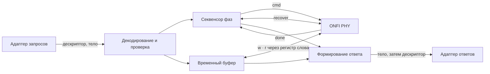
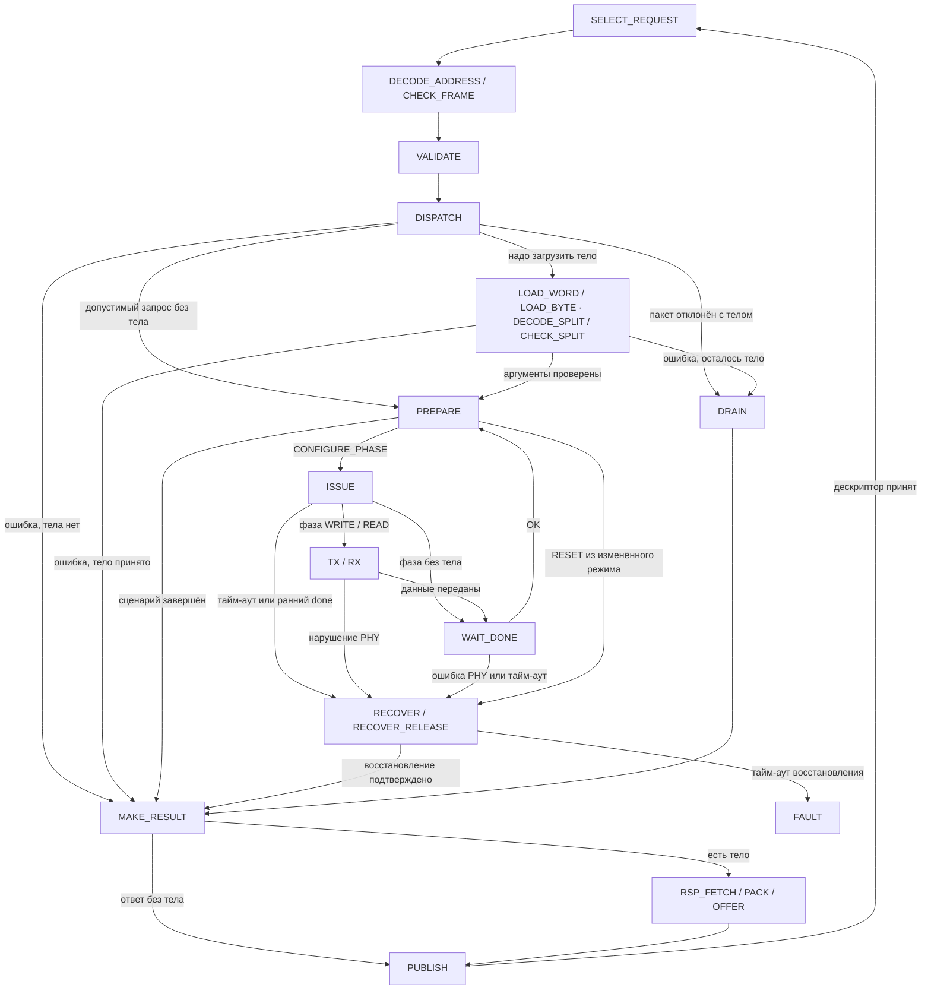

# Рабочий контракт FSM ONFI

Пакет описан в разделе «Пакетный контракт» [спецификации варианта 3](../specification/specification.typ). На границе с PHY эта реализация передаёт 64-битные слова по слайду 3. В разделе «Граница секвенсора и PHY» спецификация описывает побайтные каналы. Для подключения командного PHY нужен согласованный интерфейс или адаптер.

FSM работает в одном домене. Входной адаптер выбирает дескриптор очередного `seq`, передаёт оба слова заголовка, число фактически сохранённых слов тела, `empty` и `frame_error`. Адаптер проверяет SOP/EOP, помечает оборванный кадр и публикует дескриптор после записи тела. Для кадра без достоверного WORD 0 дескриптор не публикуется. При ошибке ядро удаляет ровно объявленное число слов тела. Новая транзакция открывается после выдачи результата. Выходной адаптер сохраняет тело до публикации дескриптора и маршрутизирует его по исходному классу. Буфер данных должен вмещать полное тело до публикации.

Каналы PHY используют `valid/ready`. Слово передаётся по фронту, когда оба сигнала равны единице. Первый байт расположен в младших разрядах. Каждый сегмент передачи упакован от младшего байта первого слова. `last` отмечает последнее слово фазы, число действительных байтов определяется из `count`. При ошибке PHY может завершить фазу до передачи всех слов. При успешном завершении после последнего принятого слова PHY выставляет `done_valid` и удерживает результат до подтверждения. `recover_ack` означает остановку старых фаз, очистку старых данных и согласованный возврат в асинхронный режим 0. Он удерживается до снятия запроса.

## Требования и согласование

| Источник | Требование | Решение и проверка |
|---|---|---|
| Фото варианта 3, пункты 1–4 | Разобрать запрос, подготовить запись, принять данные/статус, сформировать ответ | Реализовано в ядре. TB сравнивает фазы, данные и оба слова ответа |
| Фото общего задания | 64-битный Avalon-ST, раздельная ёмкость классов READ/WRITE, параметры интерфейса, модульная проверка и интеграция на Cyclone 10 LP | Разрядность пакета и классы сохранены в договоре. CDC, ёмкости и внешний Avalon-ST проверяет интеграция |
| Вариант 3, «Пакетный контракт» и «Адрес и маскирование» | Младший первый байт, ADDRESS 48 бит, LENGTH 10 бит, разная семантика LENGTH, побитовая маска | Реализовано. READ9, WRITE9, пустой и максимальный ответ, проверка ошибочного хвоста и границы страницы |
| Вариант 4 PDF, с. 4–8 и 10–13 | Старшие разряды заголовка и тела, 24-битная длина, одна FIFO ответов FWFT | Вариант 3 и слайды FSM выбраны как основа ядра. Нужны утверждение формата и согласование адаптера с Master |
| Вариант 3, «Очереди и параллельная работа» | Раздельные классы, порядок `seq`, FIFO заголовков и данных, согласованный reset | Адаптер предъявляет один выбранный дескриптор и его тело. Ядро возвращает `seq` и класс. Последовательность верна при соблюдении договора адаптером |
| Слайды 3/7 и вариант 3, «Граница секвенсора и PHY» | 64-битные FIFO в презентации, побайтные каналы в PDF FSM | Рабочий выбор 64 бит и `last` на слово с определением хвоста по `count`. Согласовать с PHY |
| Вариант 3, «Параметры и сброс» | Общий домен 125 МГц, синхронное снятие reset, предельная длина 512 байтов | 8 нс в SDC проверочной сборки и TB. Снятие reset синхронизатором верхнего уровня |
| ONFI 2.0, §§3.1, 4, 5 | Последовательности, адресные циклы, CRC параметров, обработка готовности и режима | Порядок фаз, CRC и валидация в RTL. Физические циклы и тайминги `tWB`, `tCCS`, `tITC` принадлежат PHY |

Открытые вопросы для вариантов 1/2/4: единая версия формата пакета, принадлежность арбитража `seq`, подтверждение публикации ответов после записи тела, глубины и очистка FIFO. Для PHY: общий пакет типов, размер и правила передачи последнего слова, модель NAND и адресные циклы, поддерживаемые режимы, начальная готовность и процедура возврата в mode 0. Версия ONFI 2.0 и один LUN фиксированы в этой реализации. Другим версиям нужна собственная таблица фаз. Настройки физических задержек задаёт PHY.

Входные буферы класса WRITE должны вмещать 65 слов для `09h` при 512 байтах. В выходном тракте под полный ответ нужно до 64 слов. При ширине `seq` 16 бит общее число незавершённых запросов должно быть меньше 65 536. Адаптер обязуется доставить объявленное в принятом дескрипторе число слов. Временная задержка появления слова допустима. Ранний или поздний `EOP`, отсутствие `EOP` и таймер приёма потока обрабатывает входной адаптер, который выставляет транспортную ошибку. В модели проверяется реакция ядра на этот признак и несоответствие длины. При нарушении обещанного числа слов после публикации нужен общий сброс подсистемы очередей.

## Пакет

| Слово | Поля |
|---|---|
| WORD 0 | [7:0] OPCODE, [23:8] REQUEST_ID, [33:24] LENGTH, [63:34] нули |
| WORD 1 запроса | [47:0] ADDRESS, [55:48] LAST_MASK, [63:56] нули |
| WORD 1 ответа | [7:0] STATUS_CODE, [15:8] NAND_STATUS, [23:16] FIRST_MASK, [31:24] LAST_MASK, [63:32] нули |
| Тело | Первый байт в [7:0]. В ответе верхние незначащие байты обнуляются |

В запросе LENGTH задаёт объём операции. Тело есть у WRITE и SET FEATURES. У CHANGE WRITE COLUMN перед данными идёт дополнительное слово, где [63:48] задаёт новую колонку, [47:24] размер первого сегмента, [23:0] нули. В ответе LENGTH равен фактическому числу байтов тела. При ошибке LENGTH и маски равны нулю. При успешном чтении обоим маскам присваивается FFh. Master ставит SOP/EOP/empty по ответному заголовку. Для READ9 в запросе EOP на WORD 1, а в ответе EOP на втором слове тела, empty=7.

## Порты ядра

Все сигналы относятся к `clk_i`, кроме внешнего утверждения `rst_n_i`. По активному нулю ядро прекращает обмен. Снимать сброс надо синхронно. Соседние адаптеры и PHY очищают недействительные дескрипторы и данные при том же сбросе. Каждый канал передаёт значение на положительном фронте с `valid=ready=1`. Источник удерживает `valid` и все поля до передачи. Общий reset и восстановление отменяют текущий обмен с PHY. Для `read_class` единица обозначает класс READ, ноль обозначает класс WRITE.

| Порт | Направление и ширина | Назначение |
|---|---|---|
| `clk_i, rst_n_i, phy_initialized_i` | in, по 1 | Такт, сброс и готовность PHY после стартовой инициализации. Флаг готовности стабилен во время нормального обмена |
| `req_i, req_valid_i, req_ready_o` | in record 156 бит, in 1, out 1 | Дескриптор с обоими заголовками, порядком и результатом приёма. Захватывается один раз |
| `req_data_i, req_data_valid_i, req_data_ready_o` | in 64, in 1, out 1 | Слова тела в порядке записи. Данные ассоциированы с текущим дескриптором |
| `rsp_o, rsp_valid_o, rsp_ready_i` | out record 145 бит, out 1, in 1 | Публикация после последнего переданного слова тела. Принятие дескриптора освобождает ядро для следующего запроса |
| `rsp_data_o, rsp_data_valid_o, rsp_data_ready_i` | out 64, out 1, in 1 | Слова результата. Адаптер должен принимать тело до публикации дескриптора и не делать его видимым как завершённый ответ заранее |
| `phase_o, cmd_valid_o, cmd_ready_i` | out record 113 бит при компактном кодировании, out 1, in 1 | Передача описания одной фазы PHY. Кодировка перечислений внутри FPGA выбирается компилятором |
| `w_data_o, w_last_o, w_valid_o, w_ready_i` | out 64, out 1, out 1, in 1 | Слова фазы записи. Для неполного слова действительны младшие байты, остальные нули |
| `r_data_i, r_last_i, r_valid_i, r_ready_o` | in 64, in 1, in 1, out 1 | Слова фазы чтения. Лишнее слово или несовпадение `last` вызывают восстановление |
| `done_i, done_valid_i, done_ready_o` | in перечисление из 3 значений, in 1, out 1 | Результат фазы. Успешный done следует после принятия последнего слова данных отдельной передачей |
| `recover_req_o, recover_ack_i` | out 1, in 1 | Запрос остановки фаз и восстановления PHY, затем подтверждение и снятие обоих сигналов |
| `busy_o, fault_o` | out, по 1 | Ядро обрабатывает уже принятый запрос либо заблокировано. FAULT снимается общим reset |

| Record | Поля |
|---|---|
| `request_t` | `word0`, `word1` по 64, `seq` 16, `read_class` 1, `body_words` 7, `tail_empty` 3, `frame_error` 1 |
| `response_t` | `word0`, `word1` по 64, `seq` 16, `read_class` 1. Класс и seq повторяют дескриптор запроса |
| `phase_t` | `kind` 6 значений, `opcode` 8, `address` 64, `address_kind` 4 значения, `selector` 8, `count` 24, `mode` 4 |
| `nand_address_t` | `lun` 8 (в этом профиле 0), `page.block_index` 24, `page.page_in_block` 16, `column` 16 |

| Generic | Диапазон и смысл |
|---|---|
| `g_max_length` | 1–512, макс. размер полезных данных. По умолчанию 512 |
| `g_page_bytes, g_pages_per_block` | 1–65 536, степени двойки. В тесте 2048 и 64 |
| `g_blocks_per_lun` | 1–16 777 216, предел адреса. В тесте 1024 |
| `g_read_id_bytes` | 1–512, допустимая длина ID выбранной NAND для селектора 00h. В тесте 5 |
| `g_mode_mask` | 6 бит, допустимые асинхронные режимы 0–5. Mode 0 обязателен. В тесте 0 и 1 |
| `g_phase_timeout_cycles` | Положительный предел в тактах на принятие команды, передачу данных и done. В тесте 1200, в RTL по умолчанию 1 250 000, то есть 10 мс при 125 МГц. Измерение для конкретной NAND и адаптера требуется при интеграции |
| `g_recover_timeout_cycles` | Положительный предел в тактах для каждого ожидания подтверждения восстановления. В тесте 12, в RTL по умолчанию 1 250 000 |

## Архитектура

Секвенсор хранит номер операции и индекс фазы, а таблица в пакете задаёт следующую фазу. Поэтому управляющий цикл для READ и WRITE один, хотя последовательности команд разные. На FPGA синтезируются регистр состояния, декодер фаз, компараторы, счётчики, регистры портов и буфер. Деления на размеры страницы и блока при утверждённых степенях двойки сводятся к сдвигам и выделению битов. Для проверки суммы колонки и длины используется 17-битный промежуточный регистр. Адрес вычисляется до стадии валидации пакета.

| Элемент | Назначение |
|---|---|
| `control_state`, `step_r`, `step_index_count` | Текущее состояние, выполняемая фаза и индекс в таблице |
| `req_r`, `address_r`, `address_in_range_r`, `end_column_r`, `selector_r`, `length_r`, `frame_valid_r`, `has_body_r`, `validation_status_r` | Заголовок, разобранный адрес, форма кадра и результат проверки |
| `stored_count`, `segment_header_r`, `split_column_r`, `split_length_r`, `split_first_end_r`, `split_second_sum_r`, `split_second_limit_r`, `split_header_valid_r` | Остаток слов запроса, поля заголовка 09h и промежуточные сравнения границ сегментов |
| `phase_r`, `phase_length_r`, `phase_timer_count`, `recovery_timer_count` | Поля выставленной фазы, её длина, таймер фазы и таймер восстановления |
| `buffer_r`, `ram_read_r`, `input_word_r`, `output_word_r` | Временная память по 8 бит на адрес, регистр чтения памяти, входное и выходное слова |
| `buffer_index_count`, `transfer_count`, `lane_count`, `w_last_r`, `rx_last_word_r` | Адрес буфера, число байтов фазы/тела, позиция байта внутри слова и признаки последних слов |
| `copy_count`, `signature_r`, `crc_r`, `stored_crc_r`, `candidate_features_r`, `candidate_modes_r` | Проверка копии страницы параметров |
| `feature_supported_r`, `advertised_modes_r`, `requested_mode_r`, `active_mode_r` | Проверенные возможности и запрошенный/фактический режим PHY |
| `status_r`, `nand_status_r`, `payload_length_r` | Результат контроллера, байт NAND и размер успешного тела |

Буфер хранит весь WRITE до первой команды NAND. Для READ он хранит данные до успешного завершения. Ошибка лишает частичное чтение признака валидности, поэтому оно не попадёт в ответ. RAM имеет синхронный порт чтения и запись. Обнуление RAM при сбросе не нужно: регистр состояния и счётчики исключают выдачу старой области, а следующая транзакция переписывает читаемые позиции. Внутри слова обработка идёт по одному байту, что позволяет хранить данные в одном блоке памяти и поддержать невыровненный раздел между двумя сегментами WRITE. Приём и выдача внутренних слов занимают несколько тактов. Проектная пропускная способность физического PHY с этой реализацией подлежит проверке при интеграции. В ядре один временный буфер, поэтому новый запрос запускается после передачи тела и дескриптора предыдущего ответа. Master может выдавать предыдущий уже опубликованный ответ одновременно с новой операцией NAND.

## Состояния, переходы и ошибки

| Состояние | Условие перехода или удержания |
|---|---|
| SELECT_REQUEST | Принимает дескриптор при готовом PHY, затем переходит в DECODE_ADDRESS |
| DECODE_ADDRESS, CHECK_FRAME, VALIDATE, DISPATCH | Вычисляет адрес, число слов и хвост, затем проверяет тело, заголовок, геометрию и разрешённость операции. По зафиксированному результату выбирает загрузку, подготовку фаз, сброс тела или ответ |
| LOAD_WORD, LOAD_BYTE, DECODE_SPLIT, CHECK_SPLIT | Захватывает слово, затем по байтам записывает буфер. Для 09h сначала вычисляет и проверяет границы сегментов из дополнительного слова |
| DRAIN | Удаляет ровно фактически сохранённые слова, переход к ответу после последнего |
| PREPARE, CONFIGURE_PHASE, ISSUE | Выбирает код шага, на следующем такте фиксирует поля фазы и держит их до принятия. Конец таблицы ведёт к результату или к возврату в режим 0 после RESET |
| TX_FETCH, TX_PACK, TX_OFFER | Читает байты из RAM, укладывает в слово и удерживает слово и `last` до принятия |
| RX_TAKE, RX_STORE | Принимает слово, проверяет `last`, укладывает значащие байты в RAM или служебные поля |
| WAIT_DONE | Принимает результат фазы. При успехе увеличивает индекс либо читает следующую копию страницы параметров без повторной команды EC |
| RECOVER, RECOVER_RELEASE | Ждёт выставления ack, снимает req, ждёт снятия ack. Истечение любого ожидания ведёт к FAULT |
| MAKE_RESULT, RSP_FETCH, RSP_PACK, RSP_OFFER | Выдаёт полное успешное тело, соблюдая backpressure. Ошибка и пустой ответ сразу переходят к публикации |
| PUBLISH | Удерживает дескриптор до принятия. Только затем снова готов к запросу |
| FAULT | Новые запросы заблокированы до общего reset |

| Код | Условие |
|---|---|
| 00h OK | Операция завершена |
| 01h INVALID_OPCODE | Неизвестный код |
| 02h BAD_PACKET | Транспортная ошибка, ненулевые reserved, неверное число слов тела или `empty` |
| 03h INVALID_ARGUMENT | Некорректная длина, адрес, маска или разбивка сегментов |
| 04h UNSUPPORTED | Get/Set Features не подтверждены CRC или выбранный режим недоступен |
| 05h NAND_FAIL | NAND возвратила FAIL при программировании или стирании |
| 06h TIMEOUT | Истекло ожидание PHY или PHY сообщил тайм-аут |
| 07h INTERNAL_ERROR | Некорректный ответ PHY, несовпадение настроек режима, неверные подпись/CRC всех трёх копий |

У ошибочного запроса с опубликованным дескриптором ответ сохраняет ID, opcode, класс и seq. Отклонение входного пакета не выдаёт команду PHY. Ошибки программирования после 10h могут сопровождаться изменением NAND. Ядро не повторяет операцию. При FAULT ответ может отсутствовать, верхний уровень видит `fault_o` и обязан остановить обмен до общего сброса.

## Операции

CMD идёт из таблицы кодов. `PAGE` включает колонку и строку, `ROW` только строку, `COLUMN` только колонку, `SELECTOR` один байт. `STATUS` означает 70h и READ(1).

| Код | Проверка и последовательность | Ответ |
|---|---|---|
| 01h READ | LEN > 0, область в пределах страницы. 00 → PAGE → 30 → WAIT_READY → READ(LEN) | LEN байтов |
| 02h WRITE | Как для READ, полное тело. 80 → PAGE → WRITE(LEN) → 10 → WAIT_READY → STATUS. Последний байт равен `data or not LAST_MASK` | Пустой, NAND_STATUS |
| 03h READ ID | Селектор 00h или 20h, ограничение длины по generic или 4. 90 → SELECTOR → READ(LEN) | LEN байтов |
| 04h READ PARAMETER | Селектор 0, LEN 1–256 и общий предел. EC → SELECTOR → WAIT_READY → READ(256) до первой валидной из трёх копий | LEN байтов валидной копии, CRC и подпись проверяются целиком |
| 05h ERASE | LEN 0, адрес начала блока. 60 → ROW → D0 → WAIT_READY → STATUS | Пустой, NAND_STATUS |
| 06h RESET | Адрес и LEN 0. FF → WAIT_READY. При активном режиме выше 0 — согласованное восстановление режима 0 | Пустой |
| 07h READ STATUS | Адрес и LEN 0. STATUS | Пустой, байт в NAND_STATUS |
| 08h CHANGE READ COLUMN | LEN > 0, область внутри страницы. 00 → PAGE с колонкой 0 → 30 → WAIT_READY → 05 → COLUMN → E0 → READ(LEN) | LEN байтов |
| 09h CHANGE WRITE COLUMN | LEN > 0, LAST_MASK FFh, ненулевые сегменты, второй после первого и оба внутри страницы. 80 → PAGE → WRITE(1-й сегмент) → 85 → COLUMN(2-й) → WRITE(2-й сегмент) → 10 → WAIT_READY → STATUS | Пустой, NAND_STATUS |
| 0Ah GET FEATURES | Поддержка из проверенной страницы, селектор 01h, LEN 4. EE → SELECTOR → WAIT_READY → READ(4) | 4 байта |
| 0Bh SET FEATURES | Как у 0Ah, плюс P1[3:0] в пересечении допустимых режимов PHY и NAND, остальные значащие биты нули. EF → SELECTOR → WRITE(4) → SET_TIMING → EE → SELECTOR → WAIT_READY → READ(4) и сверка параметров | Пустой после успешной сверки |

Число адресных циклов и ограничения микросхемы на частичное программирование сверяются при подключении платы. Для варианта 04 ядро читает основную и две обязательные резервные копии. При отказе всех трёх оно сообщает ошибку. Поиск дополнительных копий и восстановление голосованием не реализованы. Физическая проверка состояния R/B и интервалы переключения режима принадлежат PHY. [ONFI 2.0, инициализация](https://onfi.org/files/onfi_2_0_gold.pdf#page=42) · [Набор команд](https://onfi.org/files/onfi_2_0_gold.pdf#page=89) · [CRC и резервные копии](https://onfi.org/files/onfi_2_0_gold.pdf#page=110).
